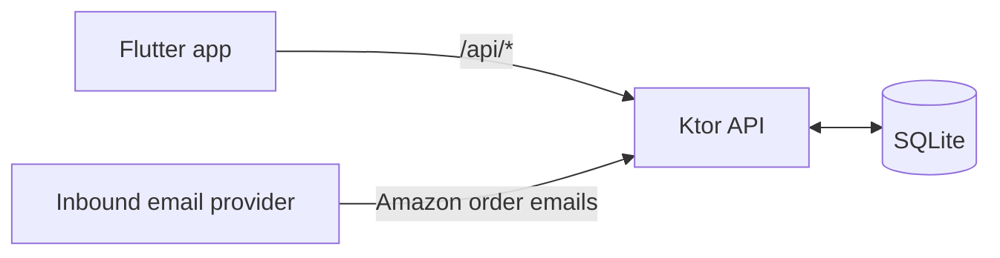

# Longview

Long-term budgeting app, built from the Longview design.

- **App:** Flutter (Android, iOS, web) — `app/`
- **API:** Kotlin + Ktor — `backend/`
- **Storage:** SQLite (one file)
- **Sign-in:** none yet. The app runs as a single local user.



> ⚠️ **No sign-in means anyone who can reach the API can see and change the data.** The API only listens on this computer (`127.0.0.1`) by default. Only set `HOST=0.0.0.0` on a network you trust.

## Features (one per design screen)

| Screen | What it does |
|---|---|
| Overview | Savings goal vs pace, catch-up advice, monthly bars, income, budget, outliers, accounts, bills this week |
| Transactions | By day or by category, search, filter, change category, see split items |
| Ideal budget | Bills, yearly costs (set aside monthly) and spending pots; auto "Paid" ticks; find repeats from history |
| Outliers | Spending outside the plan; "Make it recurring" / "Keep as one-off" when a payment repeats |
| Accounts | Daily end-of-day balances, balance overrides, logo (auto / website / social / upload / letter), manual accounts |
| Import | Upload CSV → columns auto-matched (saved per account) → preview with duplicates skipped |
| Amazon receipts | Forward or paste an order email → matched to the card payment → split into categories |
| Categories & rules | Your categories; rules on merchant, description, amount, weekday, time, account |

## Run it locally

1. Start the API:

```bash
cd backend && ./gradlew run
```

2. (Optional) load demo data that matches the design:

```bash
python3 tools/seed_demo.py
```

3. Run the app:

```bash
cd app && flutter run -d chrome
```

   On the Android emulator, point the app at your computer:

```bash
cd app && flutter run --dart-define=API_BASE_URL=http://10.0.2.2:8080
```

## API settings (environment variables)

| Variable | Meaning | Default |
|---|---|---|
| `HOST` | Address to listen on | `127.0.0.1` |
| `DB_PATH` | SQLite file | `data/longview.db` |
| `PORT` | HTTP port | `8080` |
| `CORS_HOSTS` | Allowed web origins, comma separated (empty = any) | empty |
| `RECEIPTS_EMAIL_DOMAIN` | Domain in the forwarding address | `receipts.longview.app` |
| `INBOUND_EMAIL_SECRET` | Secret your mail provider sends as `X-Webhook-Secret` | — (webhook off) |

## Tests

```bash
cd backend && ./gradlew test
```

```bash
cd app && flutter test
```

The backend tests replay the design's numbers: £3,870 saved, £397 behind, "save an extra £199", "Paid 1 Nov", "£315 of £540 put by", Amex CSV auto-matching and receipt splits.

## Not built yet

- 🔑 **Sign-in.** Removed for now. The database still has a users table, so adding Google sign-in later only means deciding which user each request belongs to (`LocalUser` in the backend).
- 🏦 **Bank links (Monzo/Starling sync).** Needs an open-banking provider (e.g. TrueLayer, GoCardless). `POST /api/accounts/{id}/sync` returns "not connected yet". CSV import works for every bank.
- 📧 **Receiving emails.** Point an inbound-email service (Postmark, Mailgun, SendGrid) at `POST /webhooks/inbound-email` with body `{"to": "...", "text": "..."}`. Until then, use "Paste an order email".
- 📄 OFX/QIF files (CSV only for now).
- 🔤 Fonts: the app asks for Inter / Space Grotesk but doesn't bundle them; add them to `pubspec.yaml` to match the design exactly.

## How money and dates are stored

- Amounts are whole pence (`Long`/`int`). Negative = money out.
- Dates are `yyyy-MM-dd` text; times `HH:mm`.
